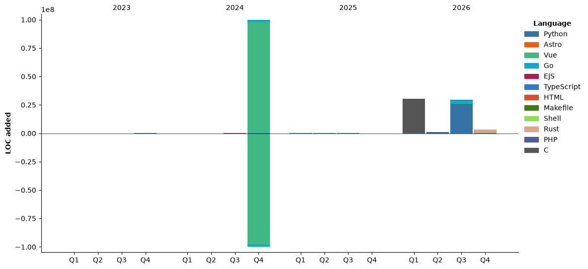

[](https://www.linkedin.com/in/izdrail/)
[](https://izdrail.com/)


---

# **Stefan Bogdan**  
**Senior Software Engineer**  
*10+ years crafting robust backend solutions & scalable architectures*  

📍 **Essex, United Kingdom**  

---

## **🛠️ Expertise**  
- **Backend Development & API Design** – High-performance, maintainable systems  
- **Cloud Infrastructure (AWS/GCP/Azure)** – Scalable, secure deployments  
- **Data-Driven Applications** – Real-time analytics & optimized databases  
- **System Architecture & Scalability** – Microservices, distributed systems  

---

## **💻 Technical Stack**  
### **Languages**  
Go (Golang), Python, JavaScript/TypeScript, PHP, C, Bash  

### **Backend & Frameworks**  
Node.js, Laravel, Supabase, Custom LLMs, Ollama  

### **Frontend & Tools**  
React, Astro, TailwindCSS, HTML5/CSS3  

### **Databases & DevOps**  
MySQL, Git, CI/CD, PCB Design (Hardware), LoRaWAN  

---

## **🚀 What I Do**  
### **Software Development**  
- Enterprise-grade backend systems  
- High-traffic e-commerce platforms  
- Custom CRM/ERP solutions  

### **Hardware & Embedded Systems**  
- Firmware for microcontrollers (Go, C)  
- PCB & electronic schematic design  
- LoRaWAN & IoT applications  
- Secure voice/chat communication systems  

### **AI & Machine Learning**  
- Custom LLM development & fine-tuning  
- Autonomous AI agent design  
- LLM infrastructure deployment  
- Self-hosted Ollama solutions  

---

## **📩 Let’s Connect**  
Have a project or need expertise? Let’s discuss how I can help!  

📅 **[Book a Meeting](https://laravelcompany.com)** (Check availability)  


--- 
## Tech Stack

```php
<?php

namespace Izdrail\Stefan;

class Profile extends Me
{
    final public function getCurrentWorkplace(): array
    {
        return [
            'name' => 'Stefan Bogdan',
            'position' => 'Senior Software Engineer',
            'company' => 'Laravel Company',
        ];
    }
    
    final public function getTechStack(): array
    {
        return [
            'languages' => [PHP::class, Python::class, Typescript::class],
            'frameworks' => [
                'backend' => [Laravel::class, Symfony::class, Django::class, FastApi::class],
                'frontend' => [Vue::class, React::class, Angular::class],
                'mobile' => [Ionic::class],
                'css' => [Tailwind::class, Bootstrap::class, Bulma::class]
            ],
            'databases' => [
                'sql' => [MySql::class, Postgres::class, Sqlite::class],
                'nosql' => [Redis::class, Mongo::class, Elastic::class, DuckDB::class]
            ]
        ];
    }

    final public function getPassions(): array
    {
        return [
            'blogs' => ['phpteacher.com', 'ecudocs.com'],
            'hobbies' => ['Fishing', 'Tracking']
        ];
    }
}
```
 <em><b>I love connecting with different people</b> so if you want to say <b>hi, I'll be happy to meet you more!</b> 😊</em>

# Weekly development breakdown
---
<!--START_SECTION:waka-->


**🐱 My GitHub Data** 

> 📦 ? Used in GitHub's Storage 
 > 
> 🏆 13,847 Contributions in the Year 2026
 > 
> 💼 Opted to Hire
 > 
> 📜 35 Public Repositories 
 > 
> 🔑 0 Private Repositories 
 > 
**I'm an Early 🐤** 

```text
🌞 Morning                2700 commits        █████████░░░░░░░░░░░░░░░░   34.78 % 
🌆 Daytime                2269 commits        ███████░░░░░░░░░░░░░░░░░░   29.22 % 
🌃 Evening                1817 commits        ██████░░░░░░░░░░░░░░░░░░░   23.40 % 
🌙 Night                  978 commits         ███░░░░░░░░░░░░░░░░░░░░░░   12.60 % 
```
📅 **I'm Most Productive on Wednesday** 

```text
Monday                   875 commits         ███░░░░░░░░░░░░░░░░░░░░░░   11.27 % 
Tuesday                  1262 commits        ████░░░░░░░░░░░░░░░░░░░░░   16.25 % 
Wednesday                1590 commits        █████░░░░░░░░░░░░░░░░░░░░   20.48 % 
Thursday                 1004 commits        ███░░░░░░░░░░░░░░░░░░░░░░   12.93 % 
Friday                   1203 commits        ████░░░░░░░░░░░░░░░░░░░░░   15.49 % 
Saturday                 976 commits         ███░░░░░░░░░░░░░░░░░░░░░░   12.57 % 
Sunday                   854 commits         ███░░░░░░░░░░░░░░░░░░░░░░   11.00 % 
```


📊 **This Week I Spent My Time On** 

```text
🕑︎ Time Zone: Europe/London

💬 Programming Languages: 
No Activity Tracked This Week

🔥 Editors: 
No Activity Tracked This Week

💻 Operating System: 
No Activity Tracked This Week
```

**I Mostly Code in Python** 

```text
Python                   22 repos            █████████░░░░░░░░░░░░░░░░   36.07 % 
PHP                      10 repos            ████░░░░░░░░░░░░░░░░░░░░░   16.39 % 
HTML                     3 repos             █░░░░░░░░░░░░░░░░░░░░░░░░   04.92 % 
Rust                     1 repo              ░░░░░░░░░░░░░░░░░░░░░░░░░   01.64 % 
JavaScript               1 repo              ░░░░░░░░░░░░░░░░░░░░░░░░░   01.64 % 
```


**Timeline**




 Last Updated on 27/11/2026 18:00:27 UTC
<!--END_SECTION:waka-->
---

